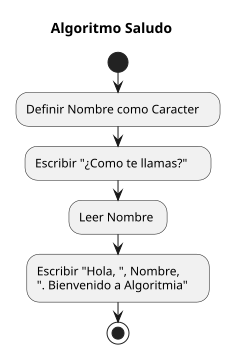
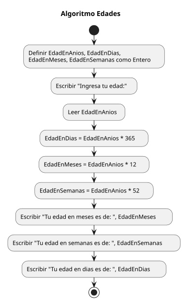
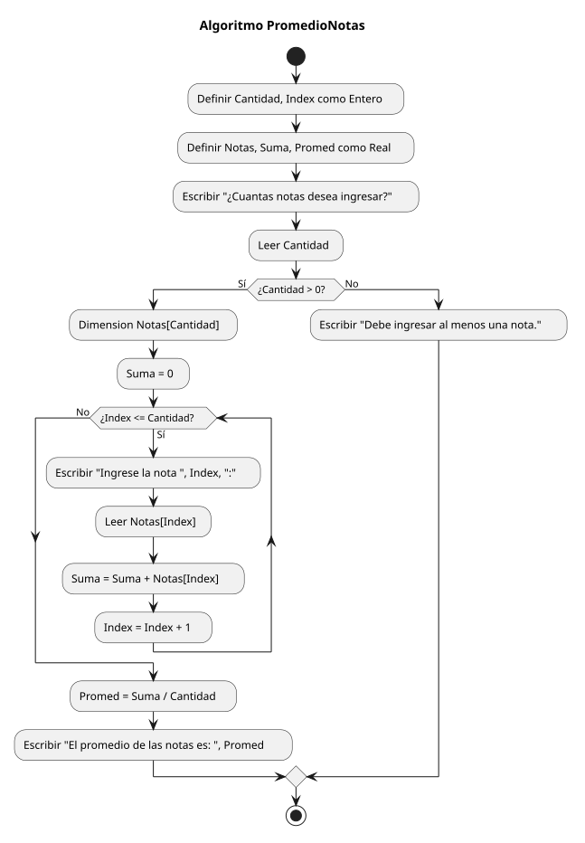
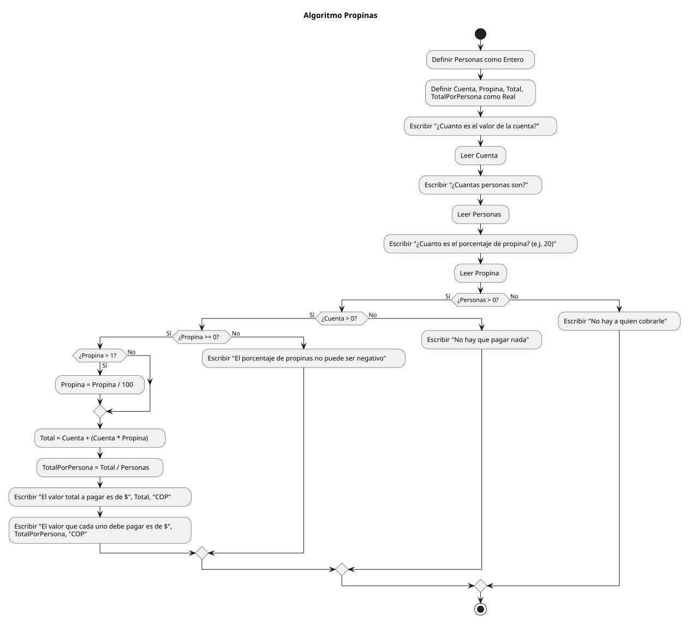

# Algoritmia S1

Repositorio de ejercicios introductorios de algoritmia desarrollados en PSeInt. Cada ejercicio incluye su pseudocódigo (`.psc`) y un diagrama de flujo en formato SVG.

## Ejercicios

### Saludo

Solicita el nombre de una persona y muestra un mensaje de bienvenida.

[Ver pseudocódigo](Saludo.psc)

### Edad en días

Lee la edad en años y calcula su equivalencia aproximada en días, semanas y meses.

[Ver pseudocódigo](EdadEnDias.psc)

### Promedio de notas

Solicita una cantidad de notas, las acumula y calcula el promedio. Comprueba que se ingrese al menos una nota.

[Ver pseudocódigo](PromedioNotas.psc)

### Propinas

Calcula el total de una cuenta con propina y cuánto debe pagar cada persona, validando los datos ingresados.

[Ver pseudocódigo](Propinas.psc)

