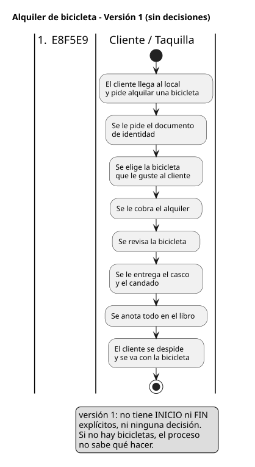
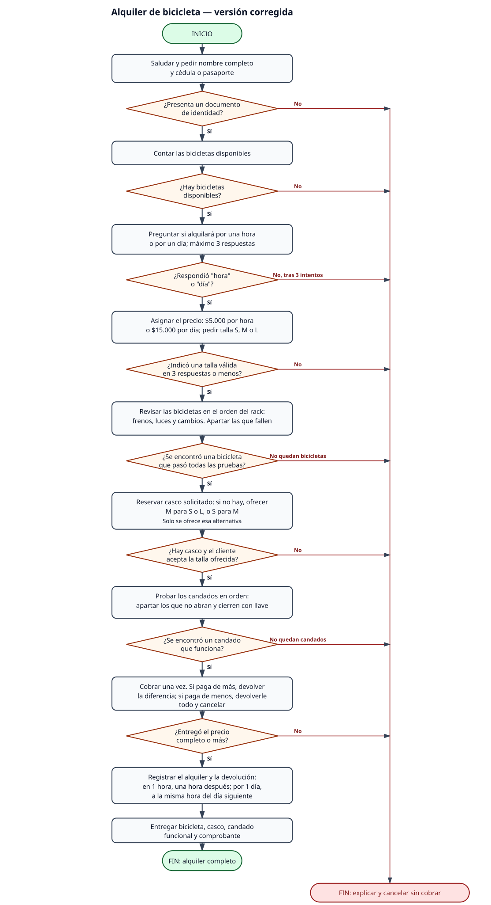

# Bitácora — MiniReto 1 · Kilómetro 0: el alquiler sin ambigüedades

**Proyecto:** Rueda Libre — alquiler de bicicletas

**Trabajo individual**

**Fecha:** 23/10/2026

---

## 1. Contexto

Cada persona de taquilla de Rueda Libre atiende distinto: unos piden el documento
al principio, otros al final; unos olvidan entregar el casco y otros cobran antes
de revisar la bicicleta. La dueña quiere un proceso que sea siempre el mismo, lo
haga quien lo haga. Un proceso que se ejecuta igual, paso a paso y con un final
claro, es exactamente un algoritmo.

Objetivo de esta bitácora: describir el proceso de alquiler como un algoritmo en
lenguaje natural, probarlo con un compañero, corregir las ambigüedades y justificar
que cumple las características de un algoritmo correcto.

---

## 2. Versión 1 del algoritmo (primera redacción)

Escribí los pasos de memoria después de mirar cómo se atiende en el local. Esta es
la versión que le entregué al compañero para que la siguiera literalmente.

1. El cliente llega al local y pide alquilar una bicicleta.
2. Se le pide el documento de identidad.
3. Se elige la bicicleta que le guste al cliente.
4. Se le cobra el alquiler.
5. Se revisa la bicicleta.
6. Se le entrega el casco y el candado.
7. Se anota todo en el libro.
8. El cliente se despide y se va con la bicicleta.

*Flujo de la versión 1: una secuencia lineal, sin ninguna bifurcación.*

[Ver versión 1 completa](algoritmos/alquiler-bicicleta-v1.md)

---

## 3. Intercambio con el compañero y ambigüedades encontradas

Intercambié mi lista con el compañero. Él siguió mis pasos **en voz alta, de forma
literal**, sin completar nada con sentido común, y yo anoté cada punto en el que no
supo qué hacer. La lista de ambigüedades quedó así:

| # | Paso | Lo que no quedó claro | Pregunta literal del compañero |
|---|------|----------------------|--------------------------------|
| 1 | Paso 1 | No dije cuándo empieza exactamente la atención. | "¿Empiezo cuando entra por la puerta, cuando habla o cuando se sienta?" |
| 2 | Paso 2 | No dije quién pide el documento ni qué pasa si el cliente no lo trae. | "¿Se lo pido yo? ¿Y si dice que no lo trae, sigo al paso 3 o se va?" |
| 3 | Paso 3 | No definí tallas ni disponibilidad; "la que le guste" no es una instrucción ejecutable. | "¿Cómo sé cuál está disponible y cuál está en buen estado? ¿Y si no queda ninguna?" |
| 4 | Paso 4 | No dije cuánto cuesta ni cuándo se cobra. | "¿Le cobro 5.000? ¿15.000? ¿En efectivo o tarjeta? ¿Antes o después de revisar la bici?" |
| 5 | Paso 5 | La revisión venía **después** del cobro: si la bici estaba rota, ya había cobrado. | "¿La reviso aunque ya le haya cobrado?" |
| 6 | Paso 6 | No dije la talla del casco ni qué hacer si no había de esa talla; tampoco si el candado se entregaba abierto o cerrado. | "¿Qué talla le doy? ¿Y si no hay? ¿Le doy el candado cerrado?" |
| 7 | Paso 7 | No dije qué datos anotar ni en qué momento. | "¿Anoto el documento? ¿El nombre? ¿La hora? ¿O solo que alquiló?" |
| 8 | Paso 8 | No hay final: no se sabe si el proceso terminó o si falta avisar la hora de devolución. | "¿Ya terminé? ¿No debo decirle a qué hora vuelve?" |
| — | Todo el algoritmo | No hay decisión de ningún tipo y no hay inicio ni fin explícitos. | "Si no hay bicicletas, ¿qué hago? No me dices nada." |

**Conclusión del intercambio:** el algoritmo de la versión 1 solo funcionaba si quien
atendía ya sabía de antemano cómo atender. Justamente lo contrario de lo que pide la
dueña.

---

## 4. Versión 2 del algoritmo (corregida)

Reescribí el algoritmo eliminando cada ambigüedad de la tabla. Agregué decisiones
(incluido el caso "no hay bicicletas"), validación de entradas y un cierre explícito.

### INICIO — Alquiler de bicicleta en Rueda Libre

1. Contar cuántas bicicletas hay en el rack con el cartel de "disponible". Guardar el número en `bicicletas_disponibles`.
2. **Si `bicicletas_disponibles` es 0**, decirle al cliente "Hoy no nos quedan bicicletas disponibles, vuelva mañana" e ir directamente al **FIN**. Si es mayor que 0, seguir en el paso 3.
3. Preguntar al cliente: "¿Qué talla de casco usa: S, M o L?". Si responde cualquier otra cosa, repetir la pregunta. Guardar la respuesta en `talla_casco`.
4. Preguntar al cliente: "¿Alquila por hora o por día?". Si responde cualquier otra cosa, repetir la pregunta. Guardar la respuesta en `duracion`.
5. Si `duracion` es "hora", `precio` <- 5.000. Si `duracion` es "dia", `precio` <- 15.000.
6. Pedirle al cliente su cédula o pasaporte. **Si el cliente no entrega ningún documento**, decirle "Sin documento no podemos alquilar" e ir directamente al **FIN**.
7. Copiar en el libro de alquiler, con letra legible: número de documento, nombre completo, `talla_casco`, `duracion`, `precio` y la fecha de hoy.
8. Revisar la bicicleta con el cliente al lado: probar el freno delantero, el freno trasero, las luces y los cambios. **Si alguno falla**, sacar la bicicleta del rack, avisar al jefe y repetir el paso 8 con la siguiente bicicleta. **Si se revisaron todas y ninguna sirve**, decirle al cliente "Hoy no podemos alquilar", tachar el registro del paso 7 e ir directamente al **FIN**, sin cobrar.
9. Pedirle al cliente el dinero: debe entregar exactamente `precio` o más. **Si entrega menos**, devolverle lo que entregó, decirle "Faltan $X" (donde `X` es `precio` menos lo entregado) y repetir el paso 9. **Si entrega de más**, entregarle el vuelto (`lo_entregado` menos `precio`).
10. Entregarle la bicicleta al cliente y pedirle que confirme en voz alta la hora en que debe devolverla (la hora actual más `duracion`).
11. Buscar en el estante un casco de la `talla_casco` registrada en el paso 3. **Si no hay de esa talla**, ofrecerle al cliente la talla más cercana (S→M, L→M, M→L). Si el cliente la acepta, entregarla; si la rechaza, decirle "Entonces alquila sin casco" y seguir en el paso 12.
12. Entregarle un candado nuevo cerrado con llave y pedirle que lo abra y lo cierre una vez frente a usted. **Si no abre o no cierra**, entregar otro candado nuevo y repetir el paso 12.
13. Entregar el comprobante de pago y agradecer al cliente.

### FIN

El cliente sale del local con la bicicleta, el casco (si lo aceptó) y el candado.

*Flujo de la versión 2: los rombos son las decisiones, los lazos de vuelta son los ciclos acotados y las terminaciones `stop` son los caminos que llevan al **FIN** sin cobrar.*

[Ver versión 2 completa](algoritmos/alquiler-bicicleta-v2.md)

---

## 5. Características de un algoritmo correcto (justificadas con el propio texto)

**Precisión.** Cada paso indica exactamente qué hacer, sin margen de interpretación:

> "Si `duracion` es "hora", `precio` <- 5.000. Si `duracion` es "dia", `precio` <- 15.000."

No dice "cobrar lo que cueste", sino la acción concreta para cada caso.

**Finitud.** Todo proceso termina: hay una salida explícita y los ciclos tienen condición de salida.

> "Si `bicicletas_disponibles` es 0, decirle al cliente [...] e ir directamente al **FIN**."

Los "repetir" de los pasos 3, 4, 9 y 12 también terminan, porque se repiten solo
mientras la respuesta no sea válida.

**Orden.** Los pasos se ejecutan en la secuencia escrita, y el cobro no ocurre antes
de saber que la bicicleta sirve:

> Paso 7: registrar → paso 8: revisar la bicicleta → paso 9: cobrar → paso 10: entregar.

Invertir el 8 y el 9 sería otro algoritmo (y el de la versión 1 lo invertía).

**Determinismo.** Misma entrada, misma salida, sin importar quién atienda:

> "Si `duracion` es "hora", `precio` <- 5.000. Si `duracion` es "dia", `precio` <- 15.000."

Dos cajeros distintos ante el mismo cliente calculan el mismo precio.

**Efectividad.** Los pasos son ejecutables por cualquier persona de taquilla, sin
conocimientos especiales ni equipo distinto al libro, el rack y el sistema de cobro:

> "Copiar en el libro de alquiler [...] número de documento, nombre completo, `talla_casco`, `duracion`, `precio` y la fecha de hoy."

No exige cálculos complejos ni criterios técnicos de mecánica.

---

## 6. Los cuatro pilares del pensamiento computacional

**Descomposición.** Partí el alquiler en cinco subprocesos independientes que se
pueden cambiar por separado sin tocar el resto:

1. Verificar disponibilidad (pasos 1-2).
2. Registrar al cliente (pasos 3-7).
3. Revisar la bicicleta (paso 8).
4. Cobrar (paso 9).
5. Entregar bicicleta, casco y candado (pasos 10-13).

**Abstracción.** Dejé por fuera los detalles que no cambian el resultado: el color y
la marca de la bicicleta, el nombre del empleado de taquilla, la ruta que hará el
cliente, cómo se fabrica el casco y qué banco procesa el pago. Lo que sí dejé dentro
es lo que afecta la decisión: cantidad de bicicletas disponibles, talla de casco,
duración, documento y monto a cobrar.

**Reconocimiento de patrones.** Con **cada cliente** se repite el mismo ciclo:
*validar los datos → entregar el recurso → cobrar → cerrar el registro*. También se
repite, en los pasos 8, 11 y 12, el patrón "si el recurso falla, usar el siguiente;
si se agotan todos, informar y terminar". Detectar ese patrón me evitó reescribir la
lógica tres veces: es la misma estructura aplicada a bicicletas, cascos y candados.

**Algoritmo final.** La versión corregida de la sección 4: un proceso de 13 pasos con
inicio, fin, decisiones y ciclos acotados, que produce siempre el mismo resultado
ante los mismos datos, sin depender de quién esté en taquilla.

---

## 7. Commits

- `feat: add MiniReto 1 - algoritmo de alquiler de bicicleta (v1 y v2) y bitácora`
