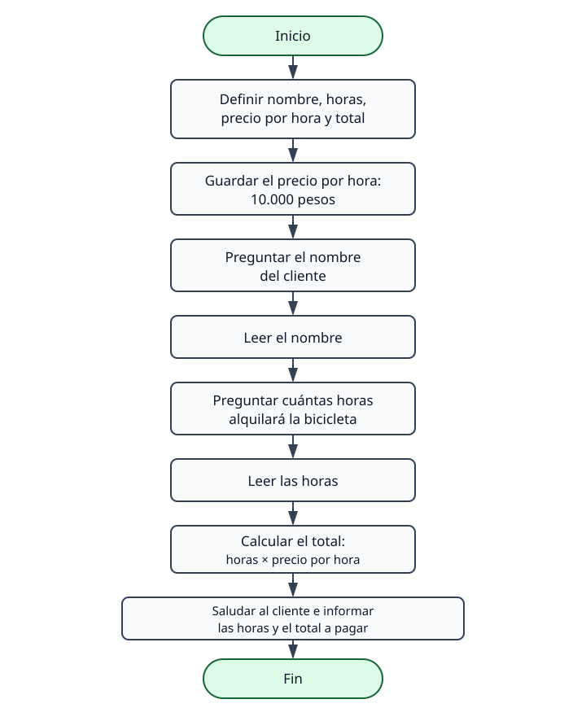

# Algoritmo de cotización básica

Este algoritmo calcula el precio de un alquiler de bicicleta urbana por horas.
Cada hora cuesta **$10.000** e incluye casco y candado. La persona de taquilla
escribe el nombre del cliente y la cantidad de horas; el programa calcula el
total y lo comunica en un saludo.

## Pasos

1. Definir el nombre del cliente como `Caracter`.
2. Definir las horas de alquiler como `Entero`.
3. Definir el precio por hora y el total a pagar como `Real`.
4. Guardar `$10.000` en `PrecioPorHora`.
5. Preguntar el nombre del cliente y leerlo.
6. Preguntar cuántas horas alquilará y leer la respuesta.
7. Multiplicar `HorasAlquiler` por `PrecioPorHora` y guardar el resultado en
   `TotalAPagar`.
8. Saludar al cliente e informar las horas de alquiler y el total que debe pagar.

El pseudocódigo ejecutable está en [01_cotizacion_basica.psc](01_cotizacion_basica.psc).

## Diagrama de flujo

