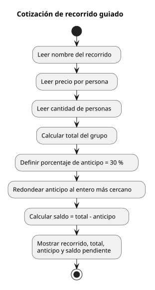

# MiniReto 3 · Recorridos guiados: del pseudocódigo al diagrama de flujo

**Trabajo individual de Algoritmia**

En Rueda Libre, los recorridos se reservan con anticipación. El cliente paga el
30 % del valor como anticipo y completa el pago el día del recorrido. En este
reto llevo ese cálculo a PSeInt y represento cada paso con un diagrama de flujo.

## Cómo está organizado

```
mini-reto-3-recorridos-guiados-del-pseudocodigo-al-diagrama/
├── README.md
├── bitacora.md
├── algoritmos/
│   ├── 02_cotizacion_recorrido.psc
│   └── diagramas/
│       └── 02_cotizacion_recorrido.svg
```

## Qué hay en cada archivo

- [La bitácora](bitacora.md) cuenta cómo se calcula la cotización e incluye la
  prueba de escritorio, el resultado esperado y una lectura de los símbolos del
  diagrama.
- [El algoritmo en PSeInt](algoritmos/02_cotizacion_recorrido.psc) lee el
  recorrido, su precio por persona y el tamaño del grupo; luego calcula el
  total, el anticipo y el saldo.
- El [diagrama de flujo](algoritmos/diagramas/02_cotizacion_recorrido.svg)
  muestra el orden de las entradas, los cálculos y la cotización final.

## El diagrama de flujo



## Qué pedía el reto y cómo va

- [x] El algoritmo calcula el valor total, el anticipo redondeado y el saldo
  pendiente a partir del total.
- [x] La prueba de escritorio muestra las variables durante el cálculo para
  cuatro personas en Sabores de Barrio.
- [x] La bitácora identifica los símbolos de inicio y fin, entrada y salida, y
  proceso.
- [x] Ejecutar el caso en PSeInt y comprobar que el resultado coincide con la
  prueba de escritorio.

La prueba manual da **$240.000** de total, **$72.000** de anticipo y **$168.000**
de saldo. PSeInt no está instalado en este entorno, así que la ejecución y la
exportación oficial quedan pendientes.
