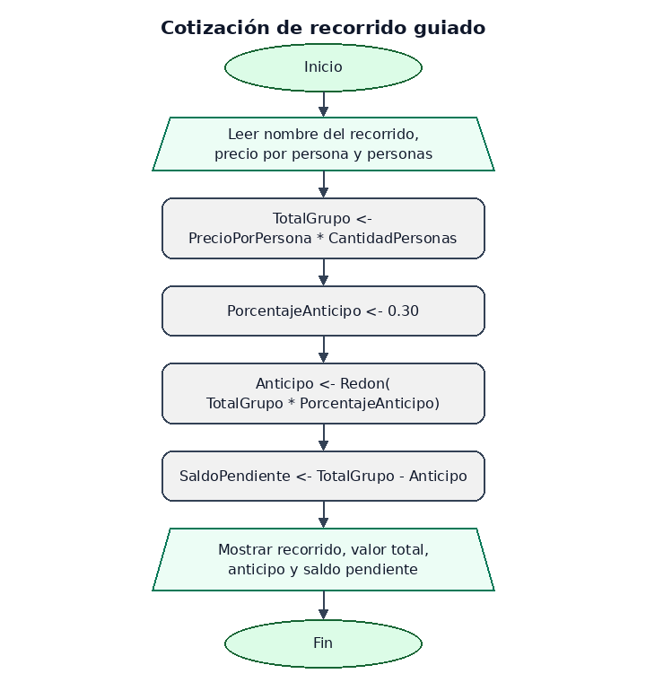

# Bitácora — MiniReto 3 · Recorridos guiados

**Proyecto:** Rueda Libre, recorridos guiados  
**Trabajo individual**

---

## 1. La reserva del recorrido

La dueña quiere que, al reservar un recorrido, la persona de taquilla pueda
explicar con claridad cuánto cuesta para todo el grupo, cuánto debe pagar el
cliente ahora y cuánto queda pendiente para el día de la salida.

Estos son los precios por persona:

| Recorrido | Distancia | Duración | Precio por persona |
|---|---:|---:|---:|
| Río y Parques | 12 km | 2 h | $45.000 |
| Sabores de Barrio | 18 km | 3 h | $60.000 |
| Reto Las Palmas | 25 km | 4 h | $85.000 |

El algoritmo recibe el recorrido, su precio por persona y cuántas personas van.
Primero multiplica para obtener el total del grupo; después calcula el anticipo
del 30 % con `Redon` y, por último, resta ese anticipo del total para saber el
saldo.

## 2. El algoritmo y su diagrama

En [02_cotizacion_recorrido.psc](algoritmos/02_cotizacion_recorrido.psc) está el
algoritmo secuencial en PSeInt. Las variables tienen nombres que explican qué
representan, y cada cálculo usa el resultado del paso anterior.

El diagrama recorre el mismo orden que el pseudocódigo: leer los datos, calcular
el total, calcular y redondear el anticipo, obtener el saldo y mostrar la
cotización. La imagen es una vista previa; queda pendiente exportar desde
PSeInt el diagrama oficial.

## 3. Prueba de escritorio

Caso: **4 personas en Sabores de Barrio**, a $60.000 por persona.

En la tabla, `—` indica que la variable todavía no tiene un valor asignado.
Para que se lea mejor, el estado se escribe como una lista en este orden:
`NombreRecorrido; CantidadPersonas; PrecioPorPersona; TotalGrupo;
PorcentajeAnticipo; Anticipo; SaldoPendiente`. Después de cada instrucción se
muestra el valor de todas las variables; las preguntas en pantalla no cambian
ese estado.

| Instrucción | Valores después de ejecutarla (en el orden indicado arriba) |
|---|---|
| Definir `NombreRecorrido` | `—; —; —; —; —; —; —` |
| Definir `CantidadPersonas` | `—; —; —; —; —; —; —` |
| Definir las variables numéricas | `—; —; —; —; —; —; —` |
| Mostrar la pregunta por el recorrido | `—; —; —; —; —; —; —` |
| Leer `NombreRecorrido` | `Sabores de Barrio; —; —; —; —; —; —` |
| Mostrar la pregunta por el precio | `Sabores de Barrio; —; —; —; —; —; —` |
| Leer `PrecioPorPersona` | `Sabores de Barrio; —; 60.000; —; —; —; —` |
| Mostrar la pregunta por la cantidad de personas | `Sabores de Barrio; —; 60.000; —; —; —; —` |
| Leer `CantidadPersonas` | `Sabores de Barrio; 4; 60.000; —; —; —; —` |
| `TotalGrupo <- PrecioPorPersona * CantidadPersonas` | `Sabores de Barrio; 4; 60.000; 240.000; —; —; —` |
| `PorcentajeAnticipo <- 0.30` | `Sabores de Barrio; 4; 60.000; 240.000; 0,30; —; —` |
| `Anticipo <- Redon(TotalGrupo * PorcentajeAnticipo)` | `Sabores de Barrio; 4; 60.000; 240.000; 0,30; 72.000; —` |
| `SaldoPendiente <- TotalGrupo - Anticipo` | `Sabores de Barrio; 4; 60.000; 240.000; 0,30; 72.000; 168.000` |
| Mostrar nombre, total, anticipo y saldo | `Sabores de Barrio; 4; 60.000; 240.000; 0,30; 72.000; 168.000` |

El anticipo se calcula con `Redon` a partir del 30 % del total. El saldo se
calcula restando el anticipo al total, no como otro porcentaje independiente.

## 4. Resultado esperado

El algoritmo debe mostrar:

- **Recorrido:** Sabores de Barrio
- **Valor total para el grupo:** $240.000 COP
- **Anticipo del 30 %:** $72.000 COP
- **Saldo pendiente para el día del recorrido:** $168.000 COP

Estos valores se comprobaron con una prueba de escritorio. Queda pendiente
ejecutar el algoritmo en PSeInt y confirmar que la salida coincida: la
aplicación no está instalada en este entorno.

## 5. Los símbolos del diagrama

Al revisar el [diagrama de flujo](algoritmos/diagramas/02_cotizacion_recorrido.png), identifico:

- **Inicio y fin:** óvalos que indican dónde empieza y termina el algoritmo.
- **Entrada y salida:** paralelogramos para leer el nombre del recorrido, el
  precio y la cantidad de personas, y para mostrar la cotización.
- **Proceso:** rectángulos para calcular el total del grupo, el anticipo y el
  saldo pendiente.

El flujo es secuencial: no hay decisiones ni ciclos, y cada cálculo usa los
valores producidos por las instrucciones anteriores.

La imagen incluida es una vista previa construida a partir del algoritmo. Falta
abrir el pseudocódigo en PSeInt y reemplazarla por la imagen exportada desde esa
aplicación.
