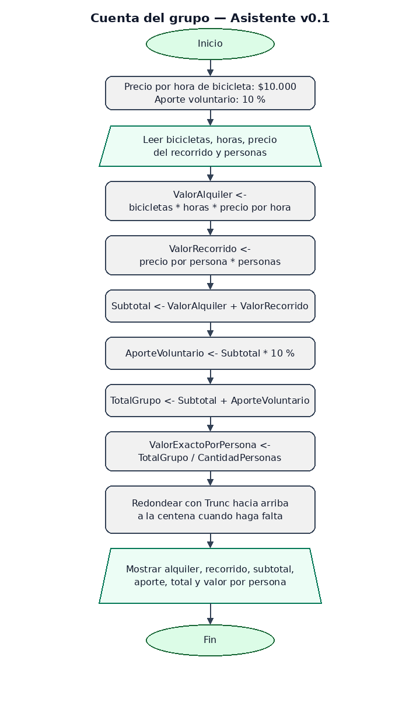

# Bitácora — MiniReto 4 · Asistente de taquilla v0.1

**Proyecto:** Rueda Libre  
**Trabajo individual**

---

## 1. La cuenta de un grupo

Cuando un grupo alquila bicicletas y reserva un recorrido, la persona de taquilla
necesita presentar una sola cuenta. El cálculo incluye el alquiler por horas, el
recorrido para todas las personas, un aporte voluntario del 10 % para mantener la
flota y el valor individual redondeado hacia arriba a la centena.

Para esta versión uso el precio de **$10.000 por bicicleta y por hora**, como en
la cotización básica del reto 2.

## 2. Descomposición antes de programar

Antes de escribir el pseudocódigo, ordené los datos y los cálculos de esta manera:

| Paso | Qué necesito calcular | Datos que utiliza |
|---:|---|---|
| 1 | Valor del alquiler de bicicletas. | Cantidad de bicicletas × horas × $10.000 por hora. |
| 2 | Valor del recorrido para el grupo. | Precio del recorrido por persona × cantidad de personas. |
| 3 | Subtotal antes del aporte voluntario. | Valor del alquiler + valor del recorrido. |
| 4 | Aporte voluntario para mantenimiento. | Subtotal × 10 %. |
| 5 | Total del grupo. | Subtotal + aporte voluntario. |
| 6 | Valor exacto por persona. | Total del grupo ÷ cantidad de personas. |
| 7 | Valor a cobrar por persona. | Redondear el valor exacto hacia arriba a la centena siguiente cuando haga falta. |

Así cada operación utiliza valores que ya quedaron calculados en los pasos
anteriores.

## 3. Cómo redondeo hacia arriba a la centena

La documentación oficial de [PSeInt: operadores y funciones](https://pseint.sourceforge.net/index.php?page=pseudocodigo.php)
describe `Trunc(X)` como la parte entera de `X`. Para un total entero positivo en
pesos y un grupo con al menos una persona uso esta fórmula:

```text
Trunc((TotalGrupo + CantidadPersonas * 100 - 1) /
      (CantidadPersonas * 100)) * 100
```

Dividir `TotalGrupo` entre `CantidadPersonas * 100` expresa cuántas centenas
corresponden a cada persona. Sumar el denominador menos uno antes de truncar
hace que cualquier fracción avance a la siguiente centena, pero deja intacta
una división exacta. Multiplicar al final por 100 devuelve el valor en pesos.
En el ejemplo del enunciado:

```text
Trunc((33.334 + 100 - 1) / 100)
= Trunc(334,33)
= 334 centenas = $33.400
```

Esta fórmula presupone que el total del grupo es un número entero de pesos y
positivo, como en los precios definidos para los recorridos y el alquiler de
bicicletas: los precios del recorrido y el alquiler son múltiplos de $5.000, así
que el subtotal también lo es; su 10 % es un número entero de pesos.

## 4. Casos de prueba calculados a mano

El aporte se calcula como el 10 % del subtotal. El valor individual exacto se
compara con el valor redondeado para comprobar que el cobro no sea menor y que
termine en una centena completa.

| Caso | Alquiler | Recorrido | Subtotal | Aporte 10 % | Total grupo | Exacto por persona | A cobrar por persona |
|---|---:|---:|---:|---:|---:|---:|---:|
| 3 personas, 3 bicicletas × 2 h, Río y Parques ($45.000) | $60.000 | $135.000 | $195.000 | $19.500 | $214.500 | $71.500 | **$71.500** |
| 4 personas, 3 bicicletas × 3 h, Sabores de Barrio ($60.000) | $90.000 | $240.000 | $330.000 | $33.000 | $363.000 | $90.750 | **$90.800** |
| Diseñado: 3 personas, 1 bicicleta × 1 h, Sabores de Barrio ($60.000) | $10.000 | $180.000 | $190.000 | $19.000 | $209.000 | $69.666,67 | **$69.700** |

En el tercer caso, `3 × $10.000 = $30.000` sería incorrecto para el alquiler:
se renta una sola bicicleta durante una hora, así que el valor correcto es
`1 × 1 × $10.000 = $10.000`.

En los tres casos el valor individual cobrado es igual o mayor que el valor
exacto y es múltiplo de 100. La ejecución de estos casos en PSeInt queda
pendiente; PSeInt no está instalado en este entorno.

## 5. El algoritmo y el diagrama

El algoritmo completo está en
[03_cuenta_grupo.psc](algoritmos/03_cuenta_grupo.psc). Presenta los datos,
calcula los valores en el orden de la descomposición y muestra un resumen para
la persona de taquilla.



La imagen es una vista previa del flujo secuencial. Queda pendiente generar y
exportar el diagrama oficial desde PSeInt, que no está instalado en este
entorno.

## 6. Qué significa la salida para taquilla

El resumen muestra la cantidad de bicicletas, las horas y las personas del
grupo; después presenta el valor del alquiler, el valor del recorrido, el
subtotal, el aporte voluntario, el total y el precio exacto y redondeado por
persona. El saldo que se reparte es el total con el aporte incluido.
