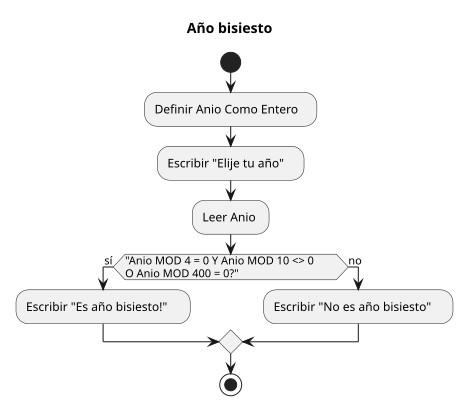
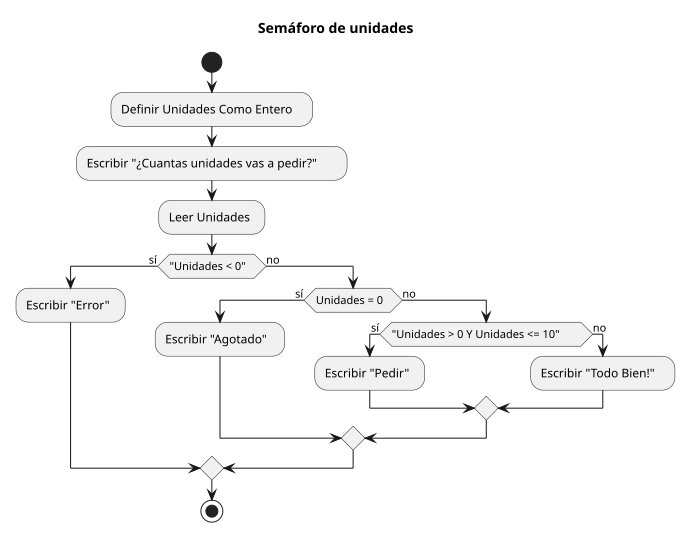
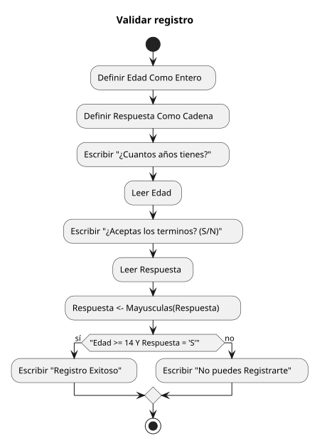
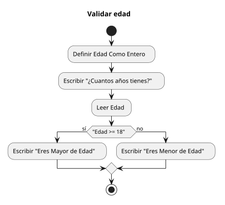
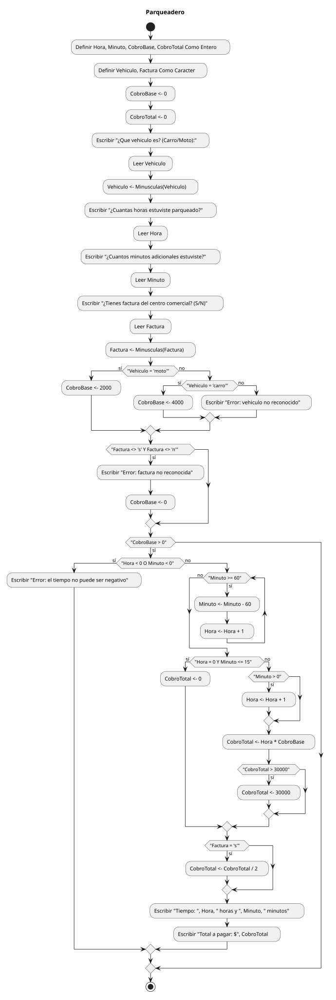

# Sesión 2 · Estructuras de decisión

Ejercicios de la segunda sesión de algoritmia en PSeInt. Cada algoritmo lee
datos, evalúa una o varias condiciones con `Si ... SiNo ... FinSi` y responde
con un mensaje distinto según el camino que recorra. Debajo de cada algoritmo
está su tabla de decisión, que enumera todas las combinaciones de condiciones
posibles, y sus pruebas de decisión, con entradas concretas y la salida
esperada.

## Ejercicios

### Bisiesto

Pregunta un año y decide si es bisiesto. La condición combina tres
comprobaciones: ser divisible entre 4, no ser divisible entre 10 y ser
divisible entre 400.

[Ver pseudocódigo](Bisiesto.psc)

Tabla de decisión:

| Divisible entre 4 | Divisible entre 10 | Divisible entre 400 | Condición completa | Salida |
|---|---|---|---|---|
| Sí | No | — | Verdadera | Es año bisiesto! |
| Sí | Sí | Sí | Verdadera | Es año bisiesto! |
| Sí | Sí | No | Falsa | No es año bisiesto |
| No | — | — | Falsa | No es año bisiesto |

Pruebas de decisión:

| Año | Recorrido de la condición | Salida esperada |
|---|---|---|
| 2024 | 2024 MOD 4 = 0 y 2024 MOD 10 = 4, distinto de 0 | Es año bisiesto! |
| 2000 | Divisible entre 4, entre 10 y entre 400 | Es año bisiesto! |
| 1900 | Divisible entre 4 y entre 10, pero 1900 MOD 400 = 300 | No es año bisiesto |
| 2100 | Divisible entre 4 y entre 10, pero 2100 MOD 400 = 100 | No es año bisiesto |
| 2023 | 2023 MOD 4 = 3, la primera parte ya es falsa | No es año bisiesto |

### Semáforo

Pregunta cuántas unidades se piden y responde según el tramo en que quede el
número: negativo, cero, entre 1 y 10, o mayor que 10. Usa decisiones anidadas,
una dentro de la otra, para descartar casos de afuera hacia adentro.

[Ver pseudocódigo](Semaforo.psc)

Tabla de decisión:

| Unidades < 0 | Unidades = 0 | 0 < Unidades <= 10 | Salida |
|---|---|---|---|
| Sí | — | — | Error |
| No | Sí | — | Agotado |
| No | No | Sí | Pedir |
| No | No | No | Todo Bien! |

Pruebas de decisión:

| Unidades | Recorrido de la condición | Salida esperada |
|---|---|---|
| -3 | -3 < 0 es verdadera, entra al primer Si | Error |
| 0 | No es menor que 0; 0 = 0 es verdadera | Agotado |
| 1 | Descarta negativos y cero; 1 > 0 y 1 <= 10 | Pedir |
| 10 | Descarta negativos y cero; 10 > 0 y 10 <= 10 | Pedir |
| 11 | Descarta todas las condiciones anteriores | Todo Bien! |
| 25 | Descarta todas las condiciones anteriores | Todo Bien! |

### Validar registro

Pregunta la edad y si la persona acepta los términos, y permite el registro
solo si tiene 14 años o más y responde «S». La respuesta se pasa por
`Mayusculas` para que una «s» minúscula también cuente.

[Ver pseudocódigo](ValidarRegistro.psc)

Tabla de decisión:

| Edad >= 14 | Respuesta = 'S' | Condición completa | Salida |
|---|---|---|---|
| Sí | Sí | Verdadera | Registro Exitoso |
| Sí | No | Falsa | No puedes Registrarte |
| No | Sí | Falsa | No puedes Registrarte |
| No | No | Falsa | No puedes Registrarte |

Pruebas de decisión:

| Edad | Respuesta | Recorrido de la condición | Salida esperada |
|---|---|---|---|
| 16 | s | Mayusculas("s") = "S" y 16 >= 14 | Registro Exitoso |
| 14 | S | 14 >= 14 es verdadera y acepta los términos | Registro Exitoso |
| 13 | S | Acepta los términos, pero 13 >= 14 es falsa | No puedes Registrarte |
| 20 | n | Tiene la edad, pero Mayusculas("n") = "N" | No puedes Registrarte |
| 10 | n | Ni la edad ni la respuesta cumplen | No puedes Registrarte |

### Validar edad

Pregunta la edad y clasifica a la persona como mayor o menor de edad. Es la
decisión más simple de la sesión: un único `Si` con dos ramas, sin condiciones
combinadas.

[Ver pseudocódigo](ValidarEdad.psc)

Tabla de decisión:

| Edad >= 18 | Salida |
|---|---|
| Sí | Eres Mayor de Edad |
| No | Eres Menor de Edad |

Pruebas de decisión:

| Edad | Recorrido de la condición | Salida esperada |
|---|---|---|
| 20 | 20 >= 18 es verdadera | Eres Mayor de Edad |
| 18 | 18 >= 18 es verdadera, justo en el límite | Eres Mayor de Edad |
| 17 | 17 >= 18 es falsa, un año menos del límite | Eres Menor de Edad |
| 10 | 10 >= 18 es falsa | Eres Menor de Edad |

### Parqueadero

Cobra el parqueo de un carro o una moto según las horas y los minutos que se
quedó, y aplica descuento si la persona tiene factura del centro comercial. Es
el algoritmo más largo de la sesión porque encadena varias decisiones: valida
el vehículo, valida la factura, descarta el tiempo negativo y recién ahí calcula
el total con tres reglas (gratuidad hasta 15 minutos, redondeo de minutos a la
hora siguiente y tope de $30.000).

[Ver pseudocódigo](Parqueadero.psc)

Tabla de decisión de las validaciones:

| Vehículo reconocido | Factura reconocida | Tiempo negativo | Salida |
|---|---|---|---|
| moto o carro | s o n | No | Calcula y muestra el total |
| moto o carro | s o n | Sí | Error: el tiempo no puede ser negativo |
| moto o carro | Otro valor | — | Error: factura no reconocida, sin cobrar |
| Otro valor | — | — | Error: vehiculo no reconocido, sin cobrar |

Reglas de cálculo, solo cuando el vehículo y la factura son válidos y el tiempo
no es negativo:

| Hora = 0 y Minuto <= 15 | Minuto > 0 | CobroTotal > 30000 | Factura = s | Regla aplicada |
|---|---|---|---|---|
| Sí | — | — | — | CobroTotal <- 0, el primer cuarto de hora no se cobra |
| No | Sí | — | — | Minuto > 0 suma una hora completa al recorrido |
| No | — | Sí | — | El total nunca supera los $30.000 |
| No | — | — | Sí | La factura del centro comercial descuenta la mitad |

Pruebas de decisión:

| Vehículo | Hora | Minuto | Factura | Recorrido y salida esperada |
|---|---|---|---|---|
| moto | 2 | 0 | n | Sin minutos sueltos; 2 * 2000 = 4000 → Total a pagar: $4000 |
| carro | 2 | 30 | n | 30 minutos redondean a hora completa; 3 * 4000 = 12000 → Total a pagar: $12000 |
| carro | 0 | 10 | n | 10 <= 15, no se cobra nada → Total a pagar: $0 |
| moto | 1 | 70 | s | 70 minutos se convierten en 1 hora y quedan 10; con el redondeo son 3 horas, 3 * 2000 = 6000 y la factura deja 3000 → Total a pagar: $3000 |
| carro | 10 | 0 | n | 10 * 4000 = 40000, pero el tope la baja → Total a pagar: $30000 |
| bicicleta | 1 | 0 | n | Vehículo no reconocido; solo imprime el error y no cobra |
| carro | 1 | 0 | x | Factura no reconocida; imprime el error y anula el cobro |
| carro | -1 | 0 | n | Hora negativa; imprime el error del tiempo |

## Antes de ejecutarlos

Cada `.psc` se abre en PSeInt con un perfil que exija definir las variables
antes de usarlas. Los mensajes de los diagramas reproducen los del
pseudocódigo; las pruebas de la tabla son un cálculo hecho a mano y quedan
pendientes de confirmar con la ejecución en PSeInt.
